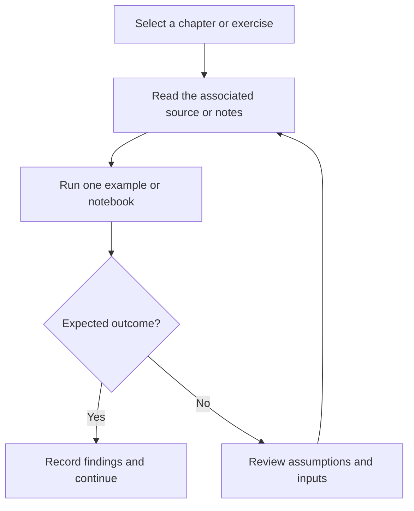

# C and C++ Data Structures and Algorithms

C and C++ practice examples covering arrays, pointers, binary search, sorting, and interview-style algorithms.

## Project focus

C/C++ exercises. Use the directory map to choose a focused example or learning topic instead of treating the repository as one application.

## Workflow



## Repository structure

| Path | Purpose |
| --- | --- |
| [`00_Advance Problems in C/`](00_Advance%20Problems%20in%20C) | Topic-organized learning material and examples. |
| [`00_Most Advance Techniques in C++/`](00_Most%20Advance%20Techniques%20in%20C%2B%2B) | Topic-organized learning material and examples. |
| [`01 - Basics of DataType & Operators/`](01%20-%20Basics%20of%20DataType%20%26%20Operators) | Topic-organized learning material and examples. |
| [`02 - If else Conditions & Loops/`](02%20-%20If%20else%20Conditions%20%26%20Loops) | Topic-organized learning material and examples. |
| [`03 - Nested Loops & Patterns/`](03%20-%20Nested%20Loops%20%26%20Patterns) | Topic-organized learning material and examples. |
| [`04 - Functions in C++/`](04%20-%20Functions%20in%20C%2B%2B) | Topic-organized learning material and examples. |
| [`05 - Binary Number System/`](05%20-%20Binary%20Number%20System) | Topic-organized learning material and examples. |
| [`06 - DataType Modifiers & Bitwise Operators/`](06%20-%20DataType%20Modifiers%20%26%20Bitwise%20Operators) | Topic-organized learning material and examples. |
| [`07 - Arrays in C++/`](07%20-%20Arrays%20in%20C%2B%2B) | Topic-organized learning material and examples. |
| [`08 - Vectors Array Like data Structure/`](08%20-%20Vectors%20Array%20Like%20data%20Structure) | Topic-organized learning material and examples. |
| [`09 - Algo_Kadane's Algorithm/`](09%20-%20Algo_Kadane%27s%20Algorithm) | Topic-organized learning material and examples. |
| [`10 - Moore's Voting Algorithm (Brute-Better-Best Approach)/`](10%20-%20Moore%27s%20Voting%20Algorithm%20%28Brute-Better-Best%20Approach%29) | Topic-organized learning material and examples. |
| [`11 - Time & Space Complexity/`](11%20-%20Time%20%26%20Space%20Complexity) | Topic-organized learning material and examples. |
| [`13 - Container with Most Water Problem/`](13%20-%20Container%20with%20Most%20Water%20Problem) | Topic-organized learning material and examples. |
| [`14 - Product of Array Except Self/`](14%20-%20Product%20of%20Array%20Except%20Self) | Topic-organized learning material and examples. |
| [`15 - Pointers/`](15%20-%20Pointers) | Topic-organized learning material and examples. |
| [`16 - Binary Search Algorithm (interactive & Recusive Method)/`](16%20-%20Binary%20Search%20Algorithm%20%28interactive%20%26%20Recusive%20Method%29) | Topic-organized learning material and examples. |
| [`17 - BinarySearch Leetcodes/`](17%20-%20BinarySearch%20Leetcodes) | Topic-organized learning material and examples. |
| [`18 - Sorting Algorithms/`](18%20-%20Sorting%20Algorithms) | Topic-organized learning material and examples. |
| [`Practice/`](Practice) | Project-specific source, resources, or learning material. |

## Getting started

```bash
git clone https://github.com/Raimal-Raja/CPP_Programming_Data-Structures_Algorithms.git
cd CPP_Programming_Data-Structures_Algorithms
```

Use a compatible C/C++ compiler. Build each source file separately because many exercises define their own entry point.

```bash
gcc -std=c11 -Wall -Wextra '00_Advance Problems in C/Find_factorial_in_single_line.c' -o exercise
./exercise
```

## Verification

Compile or run one exercise at a time, test ordinary and boundary inputs, and compare the output with its stated problem. A successful build is not proof of algorithmic correctness.

## Contributing

Include reproduction steps, the affected path, expected behavior, and the checks you ran. Keep credentials, generated environments, and unnecessary build artifacts out of commits.

## License

No top-level license file is currently tracked. Check reuse permissions with the repository owner.
